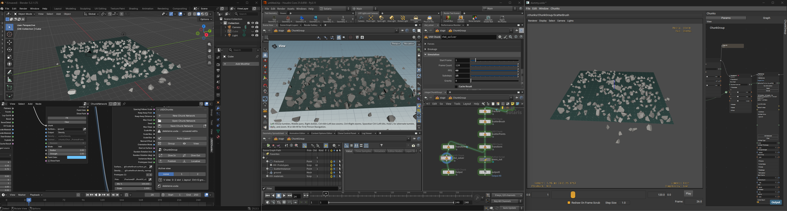

# usd_chunks



<sub>One network, open in Blender, Houdini and usdview.</sub>

# The procedural layer for USD


## ⚠️🥳 Alpha Release & Feedback Wanted!

**This project is currently in Alpha.** The core architecture is functional but actively evolving. Expect breaking changes, bugs, and incomplete features. **Do not use this in production yet.**

### 💬 We Need Your Feedback!
Because this project is in its early stages, **your input will directly shape the final product.** We are actively looking for feedback on:
* **Developer Experience:** Is the setup process smooth? Are the docs clear?
* **API Design:** Does the code feel intuitive to use?
* **Edge Cases:** Did you find any bugs or strange behaviors?

Please share your thoughts, feature ideas, or bug reports by opening a github issue.

----------------


USD is what 3D pipelines are built on, but it records what a scene is, not how it was
made. usd_chunks adds that missing layer: proceduralism stored in USD itself.
You build a node network that generates and edits a scene: reference assets, scatter
instances, bind materials, run a physics solve.
The network is saved in the `.usda` next to the scene it builds, so the file holds the
steps that make the scene, not just a baked result. Open it again and every step can still
be changed and re-cooked.


The same file runs in **usdview, Houdini and Blender**, and headless in **automation
pipelines**. One network can be a tool an artist tweaks in a viewport, then the same
network can rebuild a thousand assets on a farm.

Built for anyone whose pipeline runs on USD:

- **Manufacturing and automotive:** CAD turned into structured, simulation-ready USD
  ([CAD Import](chunks/modelling/cad_import.py)).
- **Robotics and AI simulation:** [physics solves](chunks/dynamics/rbd_solver.py) and
  synthetic training data, with [Wedge](chunks/core/wedge.py) variations written out as
  [KITTI datasets](chunks/datasets/kitti_writer.py).
- **VFX, games and visualization:** set dressing, scatter, LOD proxies
  ([Remesh](chunks/modelling/remesh_proxy.py) → [Bake](chunks/modelling/bake_textures.py)),
  and asset libraries rebuilt with `batch`.

- **One network, every host.** The same network opens as a node graph in usdview, Houdini
  or Blender, and cooks from the terminal with no UI at all.
- **Native USD, no proprietary format.** A node is a prim, a wire is a USD connection, and each
  node writes into its own layer, so the source scene isn't touched. Saving the stage
  saves the graph, and any USD tool can read it. A network is a text `.usda` and a chunk
  is a `.py`, so both diff in git and a chunk is unit-tested like any module.
- **Networks are assets.** Save a ChunkGroup to a file and reference it into another scene:
  it becomes one node you can dive into, and your edits stay overrides in your file.
- **Readable by AI agents.** Every chunk describes itself in `config()`, and a ChunkGroup's
  Description says what a saved network does. An agent can read the file, find the chunks
  it needs, and build or change a network through the same `Scene` API a person scripts.
- **Built for pipelines.** Override any param from the command line, keep the network live
  in the output, or run it once per file a glob matches:

  ```
  usdchunks run layout.usda Transform.tx=5 -o result.usda
  usdchunks batch proxy.usda Reference.file_path='assets/*.usdc' -o 'lib/{1}/{1}.usda'
  ```

- **Scriptable from Python.** Build or edit a network with `Scene`, in a script or a
  host's interpreter. What a script builds opens as a graph, and a script can add to a
  graph you already have. A forest biome, trees in noise clearings with bushes growing under them,
  shortened from [`examples/scripts/biome.py`](examples/scripts/biome.py):

  ```py
  from usd_chunks import Scene

  with Scene.new() as scene:
      ground = scene.create.mesh(prim_path="/ground", mesh_type="grid", dimx1=80, dimy1=80,
                                 width1=80.0, height2=80.0)
      forest = scene.create.noise_field(ground, prim_path="/ground", primvar="forest",
                                        size=14.0, threshold=0.45)
      trees = scene.create.scatter_points(forest, surface_prim="/ground", inst_path="/biome/trees",
                                          density_primvar="forest", max_count=120,
                                          auto_spacing=False, spacing=3.5)
      bushes = scene.create.scatter_points(trees, surface_prim="/ground", inst_path="/biome/bushes",
                                           near_prims="/biome/trees", near_radius=4.5,
                                           max_count=400, auto_spacing=False, spacing=1.4)
      scene.set_output(bushes)
      scene.save("biome_network.usda")   # the network: opens as a graph, still procedural
      scene.export("biome.usda")         # the result: plain USD
  ```

- **New tools are a short Python file.** Each node is a *Chunk*: a module that lists its
  parameters and what to do with them. From it, usd_chunks builds the node, its panel of
  widgets, and a command-line entry point. It builds the viewport handles too if you
  install [usd_gizmos](https://github.com/HuginStudios/usd_gizmos). You don't write any Qt
  or plugin boilerplate. A Reference node, cut down from
  [`chunks/usd/reference.py`](chunks/usd/reference.py):

  ```py
  from usd_chunks import chunk


  def main():
      node = chunk.Chunk("Reference")
      node.add_param(chunk.FileBrowser("file_path", extensions=[".usd*"]))
      node.add_param(chunk.LineEdit("primpath_location", "Insert to location",
                                    default_value="/Asset"))
      return node


  def execute(node):
      file_path = node.get_param("file_path").value
      if file_path:
          prim = node.get_stage().DefinePrim(node.get_param("primpath_location").value, "Xform")
          prim.GetReferences().AddReference(file_path)


  def config():
      return chunk.DefaultConfig(
          category=chunk.StandardCategory.USD,
          icon="link",
          description="Brings a USD file into the scene as a reference.",
      )
  ```

  `main()` builds the params, `execute()` cooks into the node's own layer (cleared before
  each cook), and `config()` says what the chunk *is*: where it sits in the Tab menu, the
  help a person or an AI agent reads, and when needed its pip requirements, the hosts and
  versions it runs in, extra ports and cook caching. Drop the file in a folder on
  `USD_CHUNK_DIRS` and it's in the Tab menu.

  Chunks are Python because every USD host already embeds it, so they run anywhere without
  a build step. Heavy work goes to compiled code (USD's C++, numpy, MuJoCo); see
  [Making a chunk fast](docs/fast-chunks.md).


<sub>One chunk, SwedishHouse: its sliders come from the module's own params.</sub>

## 🚀 Getting started

1. **[Install it](docs/install.md):**
   ```
   git clone https://github.com/HuginStudios/usd_chunks.git C:\src\usd_chunks
   python -m pip install -e C:\src\usd_chunks
   set PXR_PLUGINPATH_NAME=C:\src\usd_chunks\usd_chunks\hosts\usdview
   usdview anything.usda
   ```
   The install page covers PowerShell and macOS/Linux, every environment variable, and
   what to do if something doesn't show up. Using Houdini or Blender? See [Houdini](docs/houdini.md) and
   [Blender](docs/blender.md).
2. **[Use the node graph](docs/node-graph-basics.md)**: add and connect your first chunk.
3. **[Output, View and ChunkGroup](docs/core-chunks.md)**: the chunks that organise a
   graph. Output is what a graph delivers, View is where you look, ChunkGroup is a subnet.
4. **[Build a network from Python](docs/scripting.md)**: make chunks, set params and wire
   them with `Scene`, in a script or in usdview.
5. **[Learn what a Chunk is](docs/chunk-basics.md)**: params, groups, flags and an example.
6. **[Write your own chunk](docs/writing-a-chunk.md)**: `main()`, `config()`, `execute()`
   and `commit()`.

## 📦 What comes with it

The [`chunks/`](chunks/) folder has the chunks we build and test against: transforms,
references, materials, MaterialX shading, scattering, a MuJoCo rigid-body solver and more.
Most are under 500 lines, so they also work as examples to learn from.


<sub>Scatter Brush, Scatter Points and a Camera, wired together.</sub>

## 🔒 Security

A chunk is ordinary Python and can do anything Python can, just like a package you
install with `pip`. A `.usda` file can't install new chunks, but opening one runs the
chunks you have installed, with the values saved in the file. Some chunks, like the Python
chunk, run code stored in the file. Read [SECURITY.md](SECURITY.md) before opening a network
from someone else.

## 🤝 Contributing

This repo is the core framework, not a place to publish your own chunks. See
[CONTRIBUTING.md](CONTRIBUTING.md) for setup, tests and opening a PR.

## 📄 License

Apache License 2.0, the same license as OpenUSD. See [LICENSE](LICENSE).
