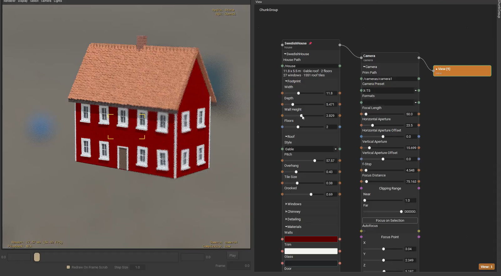
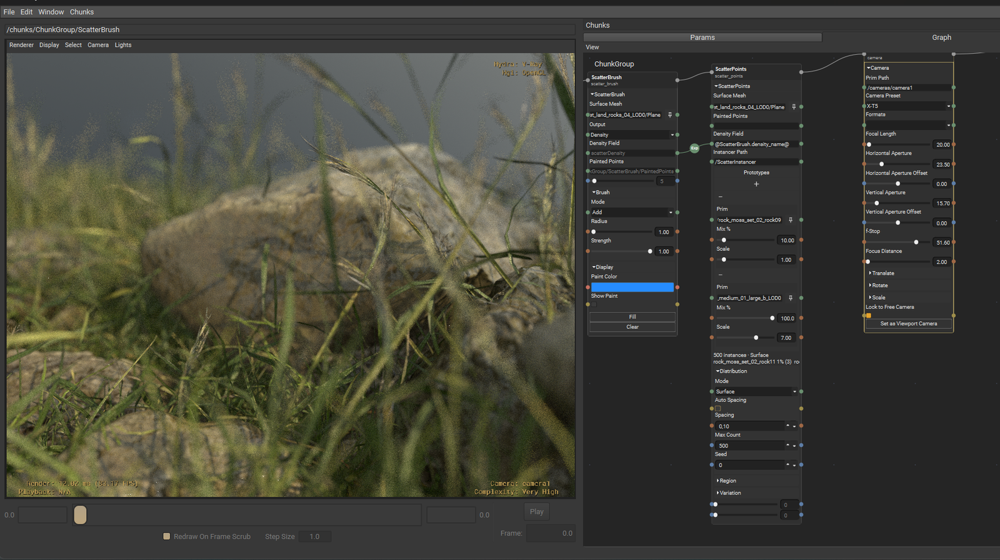

# usd_chunks



<sub>A procedural house, built with chunks.</sub>

**A framework for building procedural USD tools.**

A *Chunk* is a short Python module that lists its parameters and what to do with them.
From that one module, usd_chunks builds a node in the graph, a panel of widgets, and a
command you can run from the terminal.

- **The graph is USD.** A node is a prim and a wire is a USD connection. Saving the stage
  saves the graph.
- **Runs anywhere.** The same chunk works as a panel, as a node, or from the command line,
  without changes.
- **The UI is built for you.** The node graph and the parameter panels are built from the
  chunk's own definition. So are the viewport handles, if you install
  [usd_gizmos](https://github.com/HuginStudios/usd_gizmos).

Running a saved network from the command line:

```
usdchunks run layout.usda Transform.tx=5 -o result.usda
```

## 🚀 Getting started

1. **[Install it](docs/install.md):**
   ```
   git clone https://github.com/HuginStudios/usd_chunks.git
   python -m pip install -e ./usd_chunks
   for /f "delims=" %i in ('usdchunks plugin-path') do set PXR_PLUGINPATH_NAME=%i
   set USD_CHUNK_DIRS=C:\path\to\usd_chunks\chunks
   usdview anything.usda
   ```
   The install page covers other shells, every environment variable, and what to do if
   something doesn't show up.
2. **[Use the node graph](docs/node-graph-basics.md)**: add and connect your first chunk.
3. **[Learn what a Chunk is](docs/chunk-basics.md)**: params, groups, flags and an example.
4. **[View and ChunkGroup](docs/core-chunks.md)**: the two chunks that organise a graph.
5. **[Write your own chunk](docs/writing-a-chunk.md)**: `main()`, `config()`, `execute()`
   and `commit()`.

## 📦 What comes with it

The [`chunks/`](chunks/) folder has the chunks we build and test against: transforms,
references, materials, MaterialX shading, scattering, a MuJoCo rigid-body solver and more.
Most are under 500 lines, so they also work as examples to learn from.



<sub>Scatter Brush, Scatter Points and a Camera, wired together.</sub>

## 🕰️ Background

usd_chunks started as a way to add tools to
[usdview](https://openusd.org/release/toolset.html#usdview) without writing a
`plugInfo.json` and Qt code for every one. It has grown past that: a chunk works on a USD
stage, and usdview is one of several places you can run it.

## 🔒 Security

A chunk is ordinary Python and can do anything Python can, just like a package you
install with `pip`. A `.usda` file can't install new chunks, but opening one runs the
chunks you have installed, with the values saved in the file. Some chunks, like the Python
chunk, run code stored in the file. Read [SECURITY.md](SECURITY.md) before opening a network
from someone else.

## 🤝 Contributing

This repo is the core framework, not a place to publish your own chunks. See
[CONTRIBUTING.md](CONTRIBUTING.md) for setup, tests and opening a PR.

## 📄 License

Apache License 2.0, the same license as OpenUSD. See [LICENSE](LICENSE).
