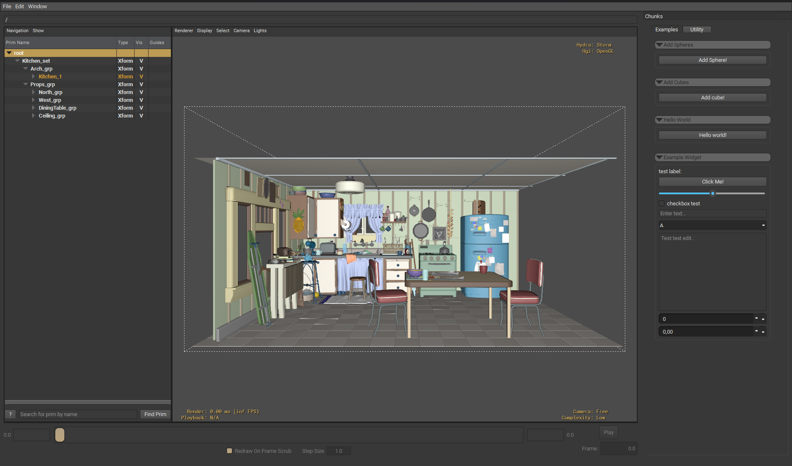

# README



## Intro

Ready to create some simple widgets in a fast and easy way for OpenUSDs usdview?
That is possible with this chunk framework. You can easily create small chunks that are meant to lower the bar for developing and sharing cool small USD programs that can easily be shared.

As an example there are some example chunks that does invis/vis, adding cubes etc under scripts to get you started. The example widget shows all available widgets a chunk have.

With this chunk framework you can copy and share chunks very easily by dropping them in a direcory that the USD_CHUNK_DIR finds.

## Setup
To set this up you need to set two environment variables after having cloned or downloaded this repo. The environment variables to be set are:

PXR_PLUGINPATH_NAME -  Add this repo location path to this envar.

PYTHONPATH - Add this repo location path to this envar.

USD_CHUNK_DIR - Add your chunk directory to this envar. No need to set if you just want to test the scripts here.

The scripts are gathered recursively and sorts out the ones with a main function in it.

## USD Chunks

Chunks are created by using python. The structure is pretty simple, lets look at a hello world example:
``` python
from usd_chunks.chunk import Chunk

def greeting(api):
    print("Hello World")

def main(api, parent=None):
    # Init a chunk widget
    chunk_api = Chunk(api, parent=parent)
    # Set the name, this is is what will show up
    # as the title name of the widghet.
    chunk_api.name = "Hello World"
    # Set the category. This is optional.
    # It decides which tab your widget will be added to.
    # If no category is applied, it will default to General.
    chunk_api.category = "Examples"
    # Creating a layout is optional. By default it is vertical layout.
    # If you create a layout, like below, the default
    # layout will be a horizontal layout.
    layout = chunk_api.create_layout()
    # Creat a button and attach the callback function directly.
    chunk_api.create_button("Hello world!", greeting, layout=layout)
    return chunk_api
```


