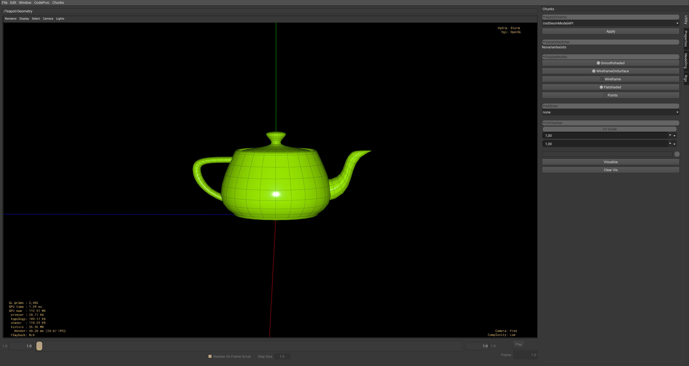
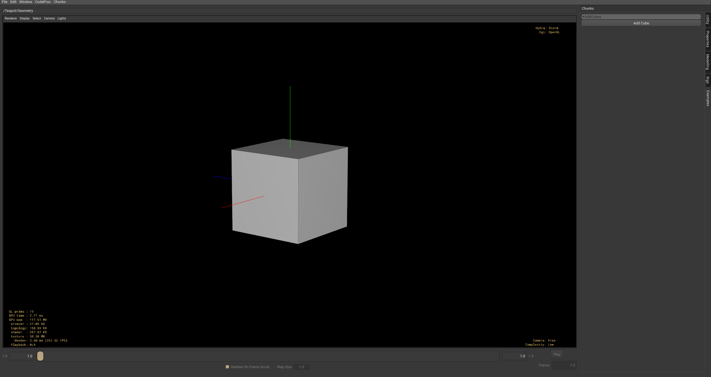

# usd_chunks



## Intro

usd_chunks is a simple library for interfacing with USD. The aim is to lower the bar for users interested in working with USD. The target was primarily to extend [usdview](https://openusd.org/release/toolset.html#usdview) by providing UI elements in order to modify the stage interactively. This target has been extended to include USD as a whole, meaning one can use usd_chunks to interface with USD regardless of the application.

When creating plugins for usdview natively:
Each plugin need to define some boilerplate code as well as define a plugInfo.json in order to be recognized by usdview. The plugin author can write some Qt code for the UI. Although fairly simple, when creating and managing many plugins, this quickly becomes tedious. The plugin as well as the UI is also not application-agnostic, meaning the same code need to be rewritten for all supported applications. usd_chunks exists to solve this.

usd_chunks is a single plugin for USD that can load 'Chunks'. A Chunk is created using python and registered with the usd_chunks plugin, and optionally represented graphically. Without writing Qt and without registering the plugin with USD. The Chunk can in turn modify the stage however one likes, such as setting attributes, creating prims, import and export of files etc.

## Chunks
A 'Chunk' is primarily a container of parameters, groups and attributes. All data encapsulated in a chunk can be modified freely. Chunks, parameters and groups are similar and can be used similarly. Parameters hold values and are ultimately the things we can interact with. Any data modified on a chunk object will send a relevant notice for users to listen for through callbacks. Callbacks are python functions, commonly for modifying the stage. Any changes to the stage through a callback will be encapsulated in a relevant UsdLayer, as to not clutter irrelevant layers. As chunks are dynamic, callbacks can also be used to modify the chunks at runtime by adding / removing params, or otherise change the behaviour of the Chunk.

### Example
A simple Chunk module providing a button, which when pressed creates a cube prim. By default, the chunks are put in a dockable widget to the right of the viewport in usdview.

``` py
from usd_chunks import chunk
from pxr import Usd


def addCube(owner, notice, sender):
    # A simple callback, adding a cube to the stage. If the /cube prim exists, create a new one with unique name
    stage = owner.get_stage()
    count = 0
    while True:
        prim = stage.GetPrimAtPath(f"/cube{count}")
        if not prim.IsValid():
            prim = stage.DefinePrim(f"/cube{count}", "Cube")
            break
        count = count + 1


def main():
    # This function should return the chunk. In this case, the chunk contains a button parameter with a callback
    button = chunk.Button("add_cube", "Add Cube")
    button.add_callback(addCube)

    chunk_api = chunk.Chunk("Add Cubes")
    chunk_api.add_param(button)

    return chunk_api


def config():
    return chunk.DefaulConfig(category=chunk.StandardCategory.EXAMPLES)

```



See more examples and use cases in [scripts](/scripts/)

A Chunk is defined in a python module like above and should be returned from a **main()** function of the same module. Similarly, a **config()** function may return a configuration of the chunk module. This module is found from the **USD_CHUNK_DIRS** environment variable, where .py files are scanned for a **main()** function returning a Chunk. 

## Params

## Groups

## How it works

## Reliance on attrs
We use [python-attrs](https://www.attrs.org/en/stable) extensively to get dataclass-like behaviour for all the chunk classes. The reasoning being that managing of chunk attributes become much easier, without having to define \_\_init\_\_ functions with heavy signatures. Chunk classes has many attributes, and thus this would fill the class definitions with unnecessary clutter. We also get attribute validation and conversion for free using attrs. Our base classes defines some standard attributes, and each higher lever of the inheritance hierarchy defines more specific attributes. All of these attributes are combined dynamically by attrs, creating the final class with a genertated \_\_init\_\_ function. 

This means we trade off some readability for cleaner code and easier maintanence, as the classes we interface with do not have explicit \_\_init\_\_ functions. We therefore rely on static type checking (using pylance) for hints on the signatures.

Most of the attrs interfacing has been abstracted away execpt for using attrs.field() for class attributes. Users do not need to think about this unless creating custom parameters or otherwise extending the chunk_core module.

## Setup

### Install

```
pip install usd-chunks
```

This pulls in `usd-core` and gives you the library plus the `usdchunks` command, with
no USD build required:

```
usdchunks run my_setup.usda
```

Note that the `usd-core` wheels on PyPI do not include usdview — it is not part of that
build. Using the usdview integration needs a full USD build that provides
`pxr.Usdviewq`; see below.

### Environment variables

**USD_CHUNK_DIRS** - Add your chunk directory to this envar. This can be a list of directories, separated by ; on windows, and : on unix systems. Nested directories are scanned for chunks as well. Chunks installed by a store are picked up automatically from **GLOBAL_USDCHUNKS** (default `~/.usdchunks/global`), which is appended after this.

**PXR_PLUGINPATH_NAME** - Only needed for the usdview integration. Point it at the installed plugin directory, which `usdchunks` will print for you:

```
usdchunks plugin-path
```

**PYTHONPATH** - Only needed when running from a clone rather than an install; add this repo's location so usdview can find the python modules.

## Build documentation
In order to build the documentation, your environment must be set to run the usd_chunks modules.
PXR_PLUGINPATH_NAME and PYTHONPATH mut be properly initialized as we do some dynamic code checking using
griffe. When all is setup and the virtual env is active, make sure to install the requirements in docs/requirements.txt
`pip install -r docs/requirements.txt`. Now calling `mkdocs serve` should generate the docs 
and be viewable in the browser.

Run docs/gen_ref_nav.py to generate the docs/reference markdown files

## License

Apache License 2.0 — see [LICENSE](LICENSE). This is the same license OpenUSD itself
ships under, so usd_chunks is compatible with the ecosystem it plugs into.
