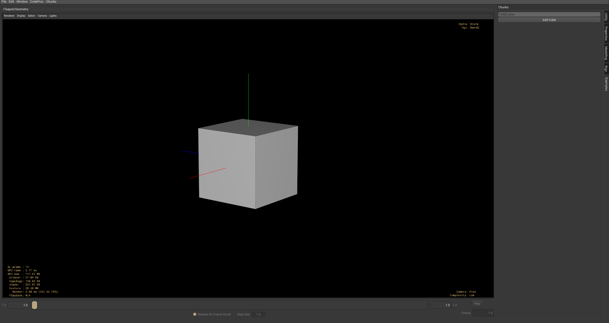

# Chunks, params and groups

A **Chunk** holds parameters, groups and attributes. The params hold the values you
change in the UI. When anything on a chunk changes, it sends a notice. Callbacks, which are
plain Python functions, listen for these notices and do the work, usually writing to the
stage. A callback can also add or remove params, change flags, or change what the chunk
does next, all while it runs.

## A minimal example

A button that adds a new cube to the stage each time it's pressed:

```py
from usd_chunks import chunk
from pxr import Usd


def addCube(owner, notice, sender):
    stage = owner.get_stage()
    count = 0
    while True:
        prim = stage.GetPrimAtPath(f"/cube{count}")
        if not prim.IsValid():
            prim = stage.DefinePrim(f"/cube{count}", "Cube")
            break
        count = count + 1


def main():
    button = chunk.Button("add_cube", "Add Cube")
    button.add_callback(addCube)

    chunk_api = chunk.Chunk("Add Cubes")
    chunk_api.add_param(button)

    return chunk_api


def config():
    return chunk.DefaultConfig(category=chunk.StandardCategory.EXAMPLES)
```



`main()` builds the chunk and its params. `config()` describes the module's
configuration. Here it sets the category, which decides where you find the chunk in the Tab
menu. [Writing a chunk](writing-a-chunk.md) covers `main()`, `config()`, `execute()` (what
the chunk does when it cooks) and `commit()` (writing files). See [chunks/](https://github.com/HuginStudios/usd_chunks/tree/main/chunks) for more
examples.

## 🎛️ Params

Params are the parts of a chunk you interact with, like sliders, buttons and menus. Each
one maps to a widget in the UI and to an `inputs:` attribute on the chunk's prim. A param
that is still at its default value may not have the attribute yet.

| Param | Value | Notes |
| --- | --- | --- |
| `Slider` | `float` \| `int` | `min_value`, `max_value`, `is_int=True` for integers |
| `Menu` | `str` | `menu_items` is the list of choices |
| `Checkbox` | `bool` | |
| `LineEdit` | `str` | Single line |
| `TextEdit` | `str` | Multi-line; `rows` sets the height |
| `FileBrowser` | `str` \| `Sdf.AssetPath` | `extensions` and `pattern` filter the dialog |
| `ColorPicker` | `(r, g, b)` | Components in the 0–1 range |
| `Button` | — | Holds no value; use it with a callback |
| `Label` | `str` | Display only, not editable |
| `Separator` | — | Visual grouping only |
| `Custom` | any | For a custom widget |

```py
divisions = chunk.Slider("divisions", "Divisions", min_value=1, max_value=32, is_int=True)
mode = chunk.Menu("mode", menu_items=["linear", "smooth"])

divisions.value = 8   # read/write through .value
```

Use `Slider` rather than `Spinbox` for numbers. `Slider` handles integers with
`is_int=True`, and it's the one the rest of the toolkit is tested with.

**Param flags** (`ChunkFlags.ParamFlags`) adjust behavior. Set one with `set_flag()`,
clear it with `unset_flag()`, check it with `has_flag()`:

```py
output_dir = chunk.FileBrowser("output_dir", "Output Directory")
output_dir.set_flag(chunk.ChunkFlags.ParamFlags.DIRECTORY)   # pick a folder, not a file

output_dir.unset_flag(chunk.ChunkFlags.ParamFlags.LABELED)   # FileBrowser is labeled by default
output_dir.has_flag(chunk.ChunkFlags.ParamFlags.LABELED)     # False
```

The flags:

- `OUTPUT`: a computed result. It's hidden in the UI, but other chunks can still read it
  as `@ChunkName.param@`.
- `LABELED`: show a label next to the widget.
- `TRANSIENT`: the value only lives in this session. It isn't saved with the scene and
  comes back empty when you reopen it.
- `FILE_EXISTING`, `DIRECTORY`: for `FileBrowser`. Only allow existing files, or only
  folders.
- `PRIM_SELECTION`, `PROP_SELECTION`: for `LineEdit`. The value is a prim or property path,
  so the UI lets you pick it from the selection.
- `PY_SYNTAX_HIGHLIGHT`, `USD_SYNTAX_HIGHLIGHT`: syntax highlighting for `TextEdit`.

**State** (`ChunkFlags.State`) describes what a param is doing right now: `HIDDEN`,
`DISABLED`, `COLLAPSED`, `SELECTED` and `STALE`. `STALE` means a result is out of date with its
inputs. The chunk sets and clears it itself (the RBD Solver does), and the graph shows it
as an amber badge on the node.

## 📁 Groups

Groups hold params and other groups, and give a chunk its layout. A `Chunk` is a group
too, so `add_param`, `add_params`, `get_param` and `get_my_params` work at every level.

- `Group`: a plain container.
- `ListGroup`: items can be added and removed while it runs, for lists of any length.
- `Vector`: a fixed set of params used as one value, like X, Y and Z.
  [Expressions](expressions.md) can refer to the whole vector as `@Node.vecParam@`.

```py
transform = chunk.Group("transform", "Transform")
transform.add_params([
    chunk.Slider("tx", min_value=-100, max_value=100),
    chunk.Slider("ty", min_value=-100, max_value=100),
])
chunk_api.add_param(transform)
```

`ChunkFlags.GroupFlags` controls how a group looks: `LABELED`, `COLLAPSABLE`, `FRAMED`,
`LIST` and `CONTEXT`. `CONTEXT` is the important one. A context group is shown as a
workspace that holds other chunks, not as a node (in the Qt plugin, it's a tab).
[ChunkGroup](core-chunks.md#chunkgroup) uses it.
