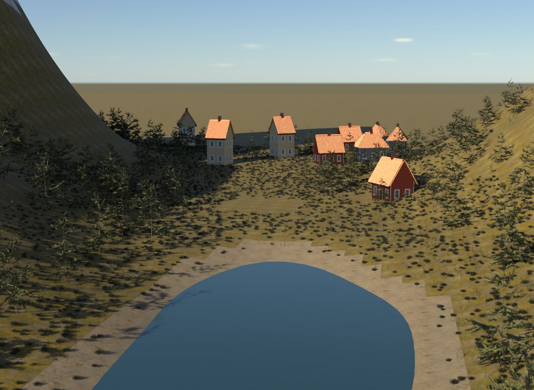
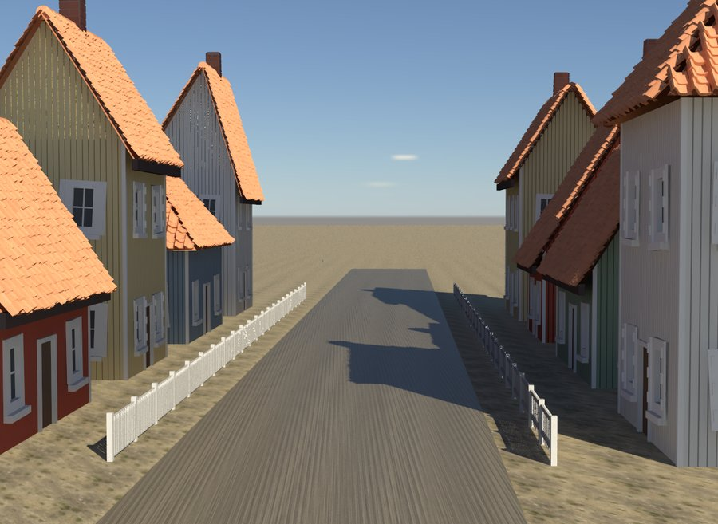
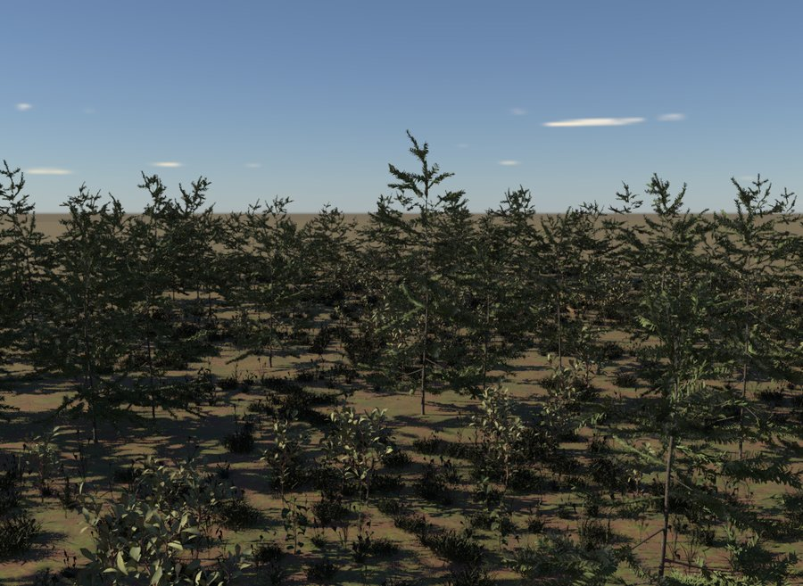
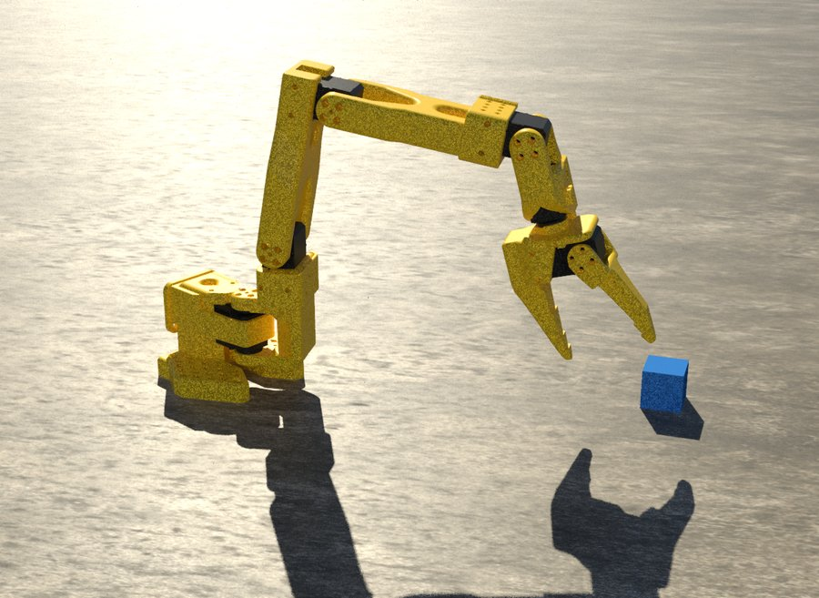
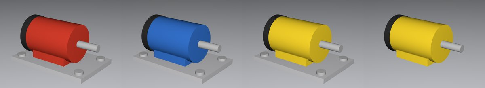

# Pipeline examples

Seven scripts in `examples/scripts/`, one per job usd_chunks is built for. Each builds a node
network, saves it, exports plain USD and renders a picture. Run one, then open the network
in usdview and change it.

| Example | Script | Shows |
| --- | --- | --- |
| [Valley biome](#valley-biome) | `valley.py` | Scatter by height: a village, forest, a lake with a sandy shore |
| [Street of houses](#street-of-houses) | `street.py` | Eight houses from one House chunk |
| [Forest](#forest) | `forest.py` | Scatter layers that grow near each other |
| [Robot for Isaac Sim](#robot-for-isaac-sim) | `urdf_to_isaac.py` | A URDF robot, posed and ready to simulate |
| [CAD to render](#cad-to-render) | `cad_to_render.py` | A STEP file with MaterialX looks |
| [Product configurator](#product-configurator) | `configurator.py` | Options as variant sets |
| [Batch a library](#batch-a-library) | `batch_library.py` | One network run over a folder of files |

## Quick start

From the repository root:

```
python examples/scripts/example_assets.py                # once: fetch the free assets, about 200 MB
USD_CHUNK_DIRS=chunks python examples/scripts/valley.py  # build, save and render
usdview examples/scripts/out/valley_network.usda         # open the network and change it
```

Results go to `examples/scripts/out/`, or to a folder you give as the first argument.

Every saved network also runs from the command line, with any param changed. Each example
below shows one.

## Valley biome



A valley where what grows depends on height. Houses stand on the flat valley floor, firs
stop at a tree line, grass grows low down, rocks lie on the peaks, and sand lines the lake.
Nothing grows through a house.

```
python examples/scripts/valley.py
usdchunks run examples/scripts/out/valley_network.usda TreeLine.max_height=18 Houses.max_count=3
```

- **Height Field** marks a band of height. Scatter Points uses it as a Density Field, and
  its Face Subset gives the band its own material (the sand, the rock).
- **Keep Away From** on each Scatter Points keeps it clear of the houses.
- **Max Slope** keeps houses on flat ground and trees off cliffs.
- The script makes the terrain itself. To use your own, point the Terrain chunk at your
  file and set the Height Fields to its heights.

## Street of houses



Eight houses from one House chunk, each with its own width, roof, floors and colours, along
a street with fences.

```
python examples/scripts/street.py
usdchunks run examples/scripts/out/street_network.usda House3.roof_style=Hip House3.floors=2
```

- A House is built from its front-left corner, door facing −Y. The far row is turned 180°.

## Forest



Firs in clearings, deadwood near the trees, shrubs under them, grass in the open. Each
layer grows near the one before (Grow Near), so there's nothing to paint.

```
python examples/scripts/forest.py
usdchunks run examples/scripts/out/forest_network.usda Clearings.seed=7 Trees.max_count=300
```

- `biome.py` is the same idea with simple shapes and no downloads.

## Robot for Isaac Sim



The SO-101 arm from its URDF, as UsdPhysics: rigid bodies, joints with limits and drives.
The script poses it, stiffens the drives, bolts its base to the floor, and adds a physics
scene and a block to pick up. Open `out/so101_scene.usda` in Isaac Sim and press Play.

```
python examples/scripts/urdf_to_isaac.py
usdchunks run examples/scripts/out/urdf_network.usda Pose.shoulder_link=20 Pose.wrist_link=30 -o arm.usda
```

- For your own robot, set URDF Import's File Path, and Mesh Root to the folder its
  `package://` paths point at.
- Pose Articulation has a slider per joint, named after the link it moves.

## CAD to render


A STEP motor read by CAD Import, with a MaterialX look per part.

```
python examples/scripts/cad_to_render.py
```

- Each part is meshed once and placed where it's used, so one material on
  `/World/Motor/Prototypes/Bolt/mesh` shades all four bolts.
- STEP files are usually Z-up: the script turns the motor upright with a Transform.
- For a small product, set the Camera's near clip low: `clippingRange=(0.01, 100.0)`.

## Product configurator



The same motor with two options, paint and base, as USD variant sets. The saved network is
the configurator.

```
python examples/scripts/configurator.py
usdchunks run examples/scripts/out/configurator_network.usda Paint.variant_selection=blue Base.variant_selection=bare -o blue_bare.usda
```

- A prim path like `/World/Motor{paint=blue}/...` makes a chunk write inside that option.

## Batch a library

One network run once per file: Reference, then Poly Reduce to 10%, over a folder.

```
python examples/scripts/batch_library.py
usdchunks batch examples/scripts/out/proxy_network.usda "Reference.file_path=library/*.usda" -o "proxies/{1}_proxy.usda" --dry-run
```

- `{1}` is what the first `*` matched: `library/torus.usda` writes `proxies/torus_proxy.usda`.
- Run with `--dry-run` first to see what it will do. `--jobs 4` runs four at a time.

## Good to know

- **Which Python.** usdview's Python (or Houdini's, Blender's) renders. The `usd-core` wheel
  builds every network but can't render, and has no MaterialX, so the CAD scripts need a full
  USD build.
- **Assets.** Poly Haven models, textures and an HDRI (CC0), and the SO-101 (Apache 2.0).
  Set `USD_CHUNK_EXAMPLE_ASSETS` to keep them somewhere else.
- **Sky.** The pictures use the Atmosphere chunk from chunk_bank for the sky and sun. Add its
  `chunks/lighting` folder to `USD_CHUNK_DIRS` to get the same look. Without it the scripts
  use a sun and an HDRI.
- **Aurora.** The scripts render with Aurora, the path tracer in the 2026-11 USD bundle, when
  it's installed, else with Storm.
- **Built from chunks.** Models come in through Reference, Reset Transform and Bind Material
  (`example_assets.add_models()`). Only the textured materials are written as USD: wiring a
  texture between shader chunks doesn't work yet.
- **Sunlight.** Turn on Normalize on a Distant Light. Without it, Intensity 3 lights almost
  nothing.
