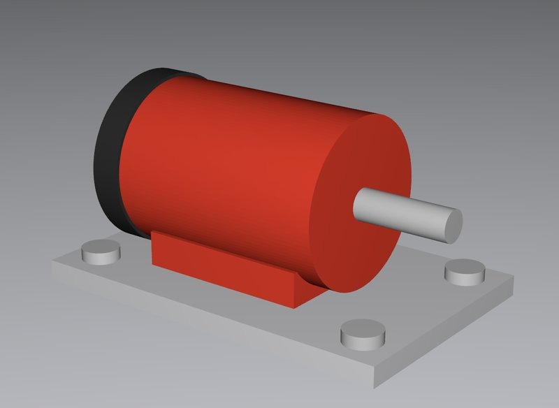
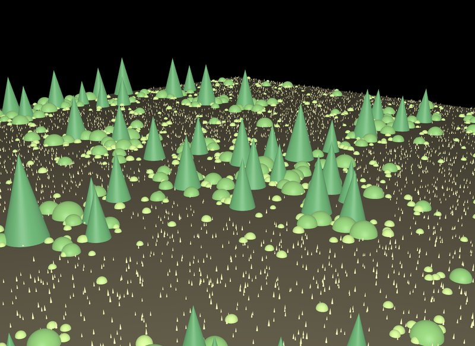
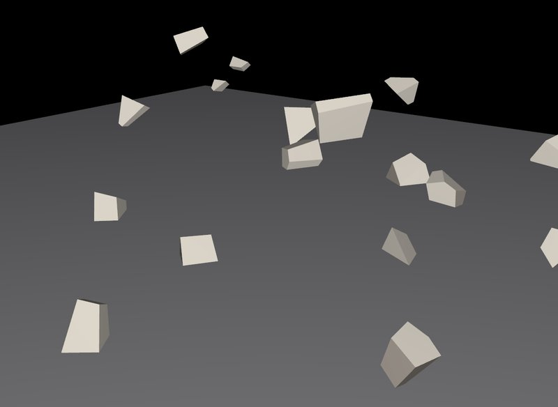
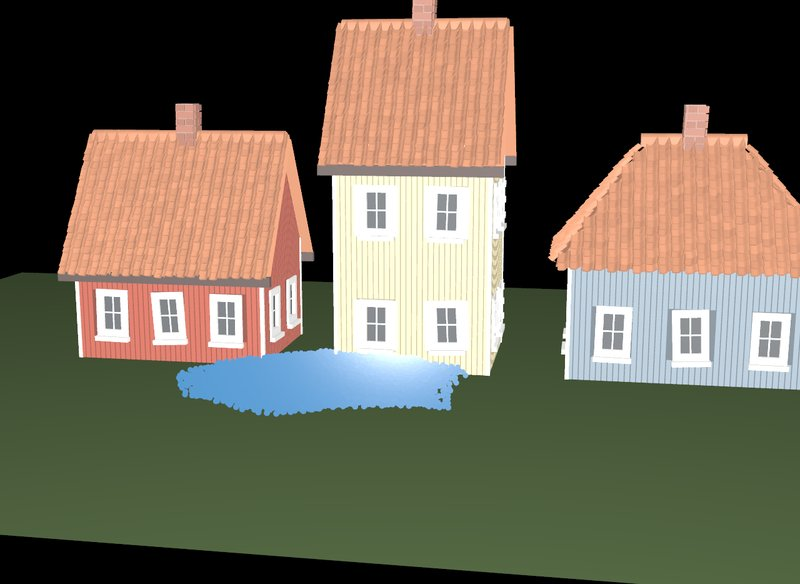

# Pipeline examples

Seven scripts in `examples/scripts/`, one per job usd_chunks is built for. Each one builds a
network with the `Scene` API, saves it, exports the result as plain USD and, where it makes
sense, renders an image. Run one, open what it saved in usdview, and change it from there or
from the command line.

| Job | Script | Shows |
| --- | --- | --- |
| [CAD to render](#cad-to-render) | `cad_to_render.py` | CAD Import, MaterialX, lights, camera, Render |
| [Product configurator](#product-configurator) | `configurator.py` | Variant sets, materials bound inside a variant, one render per option |
| [URDF for Isaac Sim](#urdf-for-isaac-sim) | `urdf_to_isaac.py` | URDF Import, Pose Articulation, a sim-ready physics scene |
| [Batch an asset library](#batch-an-asset-library) | `batch_library.py` | `usdchunks batch` over a folder, Poly Reduce |
| [Scatter a biome](#scatter-a-biome) | `biome_render.py` | Scatter Points in layers, rendered |
| [Break something](#break-something) | `boom.py` | Fracture and the RBD Solver |
| [Buildings and water](#buildings-and-water) | `houses_and_water.py` | House, Particle Solver |

For a network packed into one file you can reference anywhere, see
`examples/scripts/use_groups.py` and [Output, View and ChunkGroup](core-chunks.md).

## Before you start

Run the scripts from the repository root with `USD_CHUNK_DIRS` pointing at `chunks/`:

```
USD_CHUNK_DIRS=chunks python examples/scripts/cad_to_render.py
```

Each script writes into `examples/scripts/out/`, or into a folder you give it as the first
argument: `python examples/scripts/boom.py C:/tmp/boom`.

**Which Python.** The scripts need a Python with `pxr` and usd_chunks. There are two kinds:

- **The usd-core wheel** (`pip install -e ".[dev]"`). It builds every network and writes
  every USD file, but it can't render, and it has no MaterialX shader definitions. The
  URDF, batch, scatter, boom and water scripts work with it. They skip the image and log
  `Render: 'usdrecord' not found on PATH`.
- **A full USD build:** usdview's, Houdini's or Blender's Python. It renders, and it has
  MaterialX. Use it for the CAD and configurator scripts, and for the images.

**Optional libraries.** Some chunks need a library the first time they cook: CAD Import
needs `cadquery-ocp`, Fracture `manifold3d`, the RBD Solver `mujoco`, Particle Solver
`taichi` and Poly Reduce `fast-simplification`. The chunk asks before it installs. Set
`USD_CHUNK_AUTO_INSTALL=1` to install without asking (see [Install](install.md)).

**Rendering from a script.** The Render chunk renders when the network is committed:
`scene.commit()` in a script, or every `usdchunks run`. The examples set `mode="Command"`.
That runs USD's `usdrecord` in its own process, which makes its own OpenGL context, so
Storm works from a terminal too. Use an absolute `output_image`: a relative one is taken from
the working directory, not from the network's folder.

## CAD to render



```
python examples/scripts/cad_to_render.py
```

```
CAD Import → Transform → Standard Surface ×4 → Ground → Preview Surface → Dome Light
  → Rect Light → Transform → Camera → Render
```

`examples/assets/motor.step` is a small motor: a base plate, a body, an end cap, a shaft,
and one bolt placed four times. CAD Import reads it into USD and keeps the assembly tree,
the part names and the colours. Each part is meshed once, into a prim under
`/World/Motor/Prototypes`, and every placement references it. So binding a material to
`/World/Motor/Prototypes/Bolt/mesh` shades all four bolts:

``` py
cad = scene.create.cad_import(file_path="../../assets/motor.step",
                              primpath_location="/World/Motor", angular_deflection=6.0)
upright = scene.create.transform(cad, primpath_location="/World/Motor", rx=-90.0)
red = scene.create.standard_surface(upright, prim_path="/World/Looks/painted_red",
                                    bind_to="/World/Motor/Prototypes/Body/mesh",
                                    base_color=(0.6, 0.04, 0.02), coat=0.6)
```

- STEP files are usually Z-up, and a new Scene is Y-up. The Transform turns the assembly
  upright. Or set the stage to Z-up with `stage_settings(up_axis="Z")`.
- Units are read from the file and converted to the stage's: the motor is 22 cm long.
- Under the import root sits the STEP file's own assembly node, so the parts are at
  `/World/Motor/Motor/plate`, `/World/Motor/Motor/bolt_0`, and so on.
- **The camera's near clip is 1 unit by default.** In a metres stage, that hides
  everything closer than a metre. For a small product, set
  `clippingRange=(0.01, 100.0)` on the Camera.
- Lower Angular Deflection for smoother curved surfaces; the motor uses 6 degrees.
- In Storm, metal is lit only by the dome light's texture. With an untextured dome, fully
  metallic parts render black, which is why the example keeps metalness low. Give the Dome
  Light an HDR image, or render with a path tracer, for real metal.

For your own file, change `file_path` and the paths in `bind_to`. List the parts with
`usdcat out/cad_scene.usda` or look in usdview's Prim view.

## Product configurator


```
python examples/scripts/configurator.py
```

The same motor, with two variant sets on `/World/Motor`: `paint` (red, blue, yellow) and
`base` (plate, bare). The script renders four options. The saved network is the configurator
itself.

Two things make it work:

1. **Add Variants** creates the sets and their names:

    ``` py
    scene.create.variant(last, primpath_location="/World/Motor", variant_entries=[
        {"vs_name": "paint", "v_names": "red, blue, yellow", "v_default": "red"},
        {"vs_name": "base", "v_names": "plate, bare", "v_default": "plate"},
    ])
    ```

2. **A variant in the prim path** makes a chunk write inside that variant. `{paint=blue}`
   after `/World/Motor` means "inside the blue variant of the paint set on /World/Motor":

    ``` py
    scene.create.bind_material(last, material_path="/World/Looks/paint_blue",
                               primpath_location="/World/Motor{paint=blue}/Prototypes/Body/mesh")
    scene.create.property_editor(last, prim="/World/Motor{base=bare}/Motor/plate",
                                 edits='visibility = "invisible"')
    ```

    Bind Material, Property Editor, Transform, the material chunks and most chunks that take
    a prim path accept this.

**Set Variant** picks the option. Name it, and you can switch options from the command line
without opening the file:

```
usdchunks run examples/scripts/out/configurator_network.usda Paint.variant_selection=blue Base.variant_selection=bare -o blue_bare.usda
```

The exported `out/configurator.usda` keeps the variant sets. Any USD viewer can switch
options in it, with no usd_chunks installed.

## URDF for Isaac Sim


```
python examples/scripts/urdf_to_isaac.py
```

```
Stage Settings (Z up) → URDF Import → Pose Articulation → Property Editor → Inline USD
  → lights → Camera → Render
```

URDF Import turns a URDF robot into UsdPhysics: each link is a rigid body with its mass,
each collision shape gets `CollisionAPI`, each joint becomes a `PhysicsRevoluteJoint`,
`PhysicsPrismaticJoint` or `PhysicsFixedJoint` with its limits, and the base gets
`ArticulationRootAPI`. Pose Articulation has one slider per moving joint, named after the
link that joint moves. It also sets each joint drive's target angle.

What the example adds for a simulator:

- **Stiffness on the drives.** URDF carries joint damping but no stiffness, so a drive would
  hold nothing. A Property Editor sets `float drive:angular:physics:stiffness = 400` on the
  three joints.
- **A physics scene, a floor, and a fixed joint** bolting the base to the world, written as
  plain USD with Inline USD. Leave the fixed joint out for a mobile robot.

Open `out/desk_arm_scene.usda` in Isaac Sim and press Play. For your own robot, set
`file_path` to its `.urdf` and Mesh Root to the folder that `package://` paths are found
in. Robots in centimetre stages need `scale=100`. URDF Import converts STL meshes itself.
Other mesh formats are only referenced, so they show only where USD can read that format.

## Batch an asset library

```
python examples/scripts/batch_library.py
```

One network, run headless once per file. The script writes three dense stand-in assets to
`out/library/`, builds a two-chunk network (Reference → Poly Reduce at 10%) and runs it over
the folder with the CLI:

```
usdchunks batch out/proxy_network.usda "Reference.file_path=library/*.usda" -o "proxies/{1}_proxy.usda" --dry-run
usdchunks batch out/proxy_network.usda "Reference.file_path=library/*.usda" -o "proxies/{1}_proxy.usda"
```

- The glob in the override drives the batch. `{1}` is what its first `*` matched, so
  `library/torus.usda` writes `proxies/torus_proxy.usda`.
- Patterns are relative to the network's folder, not the shell's.
- Always run `--dry-run` first. It lists every input and where each result goes.
- `--jobs 4` runs four at a time. The command exits with 1 and lists the failures if any run
  failed.
- Each proxy references its source asset and overrides the reduced meshes on top. Add
  `--relative` to write those references relative to the output, so the folders can move.

An asset needs the usual layout, a root Xform with its meshes under it. A file whose root
prim *is* a Mesh comes in through Reference as an Xform, and Poly Reduce finds no mesh in
it. The [batch skill](https://github.com/HuginStudios/usd_chunks/blob/main/skills/usd-chunks-batch/SKILL.md)
has every flag.

## Scatter a biome



```
python examples/scripts/biome_render.py
```

`biome.py` builds the forest: a Noise Field makes clearings, and four Scatter Points layers
grow from each other (bushes near trees, ferns near bushes, grass away from trees). The
render script adds a soil material, a sun, a sky, a camera and a Render. It reuses the
same network by calling `biome.build(scene)`.

Try a new set of clearings without touching the script:

```
usdchunks run examples/scripts/out/biome_render_network.usda NoiseField.seed=7
```

Point each layer's `prototypes` at real assets for a real forest.

## Break something



```
python examples/scripts/boom.py
```

```
Ground → Cube → Transform → Preview Surface ×2 → Fracture → RBD Solver → lights → Camera → Render
```

A 1 m stone block is dropped from 5 m. **Fracture** breaks it in advance into a tree of
pieces that fit together exactly, with one material on the outside and another on the
cuts. The **RBD Solver** drops it with MuJoCo. When an impact is stronger than a piece's
Strength, the piece breaks into its children. The whole fall is baked as animation on a
PointInstancer. Open `out/boom.usda` in usdview and scrub the timeline.

- Strength is in multiples of a piece's own weight. Lower means it breaks more easily; the
  example uses 1.
- Break Kick is how fast new pieces spring apart.
- Headless (scripts, `usdchunks run`), the solver bakes when it cooks. In a UI, press
  **Run Simulation**.

```
usdchunks run examples/scripts/out/boom_network.usda Fracture.seed=3 RBD.strength=4
```

[Breakage](breakage.md) explains the whole setup.

## Buildings and water



```
python examples/scripts/houses_and_water.py
```

Three **House** chunks, each with its own width, roof style, floors and colour. Then a
block of water thrown sideways onto the ground by the **Particle Solver** (MLS-MPM in
Taichi, on the GPU when there is one), baked as points over 48 frames.

- Without a Container, the sim's box is the source block grown by Margin, and it reaches
  down to the colliders under it (here the ground). Its walls are solid but invisible, so
  give the water room: the example uses `margin=3.0`.
- A Container gives the box from a prim's bounds instead. The box is always made a cube,
  and a hidden prim has no bounds, so keep the container visible while the sim reads it.
- Give `material_prim` a material, or a renderer draws the points in their display colour.

```
usdchunks run examples/scripts/out/houses_network.usda Cottage1.roof_style=Hip Cottage1.floors=2
```
